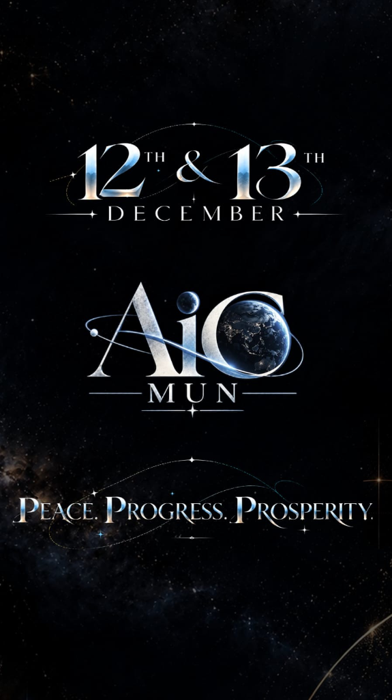

# AiG MUN 2026 — Official Conference Website
> **"Peace. Progress. Prosperity."**  
> *Model United Nations Conference — 12th & 13th December 2026*  
> 🌐 **Live Website**: [https://aig-mun-2026.tg7012.workers.dev/](https://aig-mun-2026.tg7012.workers.dev/)



A luxury, futuristic, dark-themed official website engineered for **AiG MUN (Model United Nations)**. Inspired by celestial aesthetics, international diplomacy, and space-inspired elegance, this web application serves prospective delegates, institutional delegations, executive board members, faculty advisors, and conference partners.

---

## 🌟 Key Highlights

- **Celestial Design Language**: Deep space black (`#03050B`), midnight navy (`#080F1D`), metallic silver/chrome typography, celestial ice blue accents (`#8CCEFF`), and atmospheric depth.
- **Dynamic 2D Canvas Starfield**: Multi-layered depth parallax, sinusoidal twinkling, interactive cursor reaction, occasional meteors (shooting stars), and subtle constellation linkages. Fully honors `prefers-reduced-motion`.
- **Live Timezone-Safe Countdown**: Real-time ticker counting down to **12th December 2026, 09:00 AM IST** (Asia/Kolkata timezone).
- **Single Source of Truth Configuration**: Every piece of conference information (dates, committees, registration status, schedule, secretariat, contacts) is centralized in `src/config/conferenceConfig.ts`. The organizing team can modify content without writing a single line of React code.
- **Transparent Brand Asset Pipeline**: Authentic AiG MUN brand artwork and emblem extracted directly from original reference artwork with smooth atmospheric blending.
- **Priority Delegate Alert Registry**: Fully client-side notification list with `localStorage` persistence and celebratory confetti effects, ensuring prospective delegates are alerted the moment registrations open without requiring a backend database.
- **Two-Day Interactive Schedule & Calendar Sync**: Tabbed itinerary for 12th & 13th December with one-click **Save to Calendar (.ics)** generation for Google Calendar, Apple Calendar, and Outlook.
- **Production-Ready & Static-First**: Built with React, TypeScript, Vite, and Tailwind CSS. Zero external server costs, 100% free hosting compatibility with **Cloudflare Pages**.

---

## 🚀 Quick Start (Local Development)

### Prerequisites

- **Node.js**: v18.0.0 or higher (v20+ recommended)
- **npm**: v9.0.0 or higher

### Installation & Run

1. Clone or download the repository:
   ```bash
   git clone https://github.com/gmt5723/aig-mun-2026.git
   cd aig-mun-2026
   ```

2. Install dependencies:
   ```bash
   npm install
   ```

3. Launch the development server:
   ```bash
   npm run dev
   ```

4. Open [http://localhost:5173](http://localhost:5173) in your web browser.

5. Test production build:
   ```bash
   npm run build
   npm run preview
   ```

---

## 🛠️ How to Update Conference Information

All content is managed inside a single file:  
📁 `src/config/conferenceConfig.ts`

### 1. Activating Delegate Registrations

When your official Google Form, Delegate Portal, or payment gateway link is ready:

```typescript
// src/config/conferenceConfig.ts
registration: {
  isOpen: true, // <-- Change to true
  statusText: "Registration Now Live",
  externalUrl: "https://forms.google.com/your-official-form-link", // <-- Paste your link
  earlyBirdDeadline: "15th November 2026",
  regularDeadline: "30th November 2026",
  delegateFee: "₹1,500 / $25 USD",
  // ...
}
```

### 2. Announcing Committees

To reveal finalized committees, change `areAnnounced` to `true` and update the committee list:

```typescript
// src/config/conferenceConfig.ts
committees: {
  areAnnounced: true, // <-- Set to true
  announcementNotice: "Official committee matrices and agendas are now confirmed.",
  items: [
    {
      id: "unsc",
      name: "United Nations Security Council",
      shortName: "UNSC",
      category: "Security Council",
      difficulty: "Advanced",
      agenda: "De-escalation of Multilateral Space Militarization and Orbital Neutrality Accords",
      description: "Deliberating on sovereign territorial claims and weaponization beyond the Kármán line.",
      guideUrl: "https://your-domain.com/guides/unsc-2026.pdf" // Optional link to Background Guide
    },
    // Add additional committees here...
  ]
}
```

### 3. Publishing Official Session Timings

To reveal the official hour-by-hour timeline for Day 1 and Day 2:

```typescript
// src/config/conferenceConfig.ts
schedule: {
  isAnnounced: true, // <-- Set to true
  // Update slots with exact times
  days: [
    {
      dayNumber: 1,
      // ...
      slots: [
        {
          time: "08:30 AM - 09:30 AM",
          title: "Registration & Kit Handover",
          description: "Credential verification at Main Assembly Foyer.",
          badge: "Arrival"
        },
        // ...
      ]
    }
  ]
}
```

### 4. Adding Secretariat & Organizing Team Members

To display member portraits and biographies:

```typescript
// src/config/conferenceConfig.ts
secretariat: {
  isAnnounced: true, // <-- Set to true
  members: [
    {
      id: "sg",
      name: "Your Name",
      role: "Secretary-General",
      division: "Executive Secretariat",
      bio: "Leading the strategic and diplomatic agenda for AiG MUN 2026.",
      image: "/assets/team/secretary-general.jpg", // Place image in public/assets/team/
      email: "sg@aigmun.org",
      linkedin: "https://linkedin.com/in/yourprofile"
    }
  ]
}
```

### 5. Updating Brand Assets & Images

- **Conference Poster**: Replace `public/assets/aig-mun-poster.png`
- **Transparent Logo**: Replace `public/assets/aig-mun-logo-transparent.png`
- **Favicon**: Update `public/favicon.svg`

---

## ☁️ Deployment Guide (Cloudflare Pages — 100% Free)

This project is optimized for zero-cost deployment on **Cloudflare Pages** with automatic CI/CD from GitHub.

### Step-by-Step Setup:

1. **Push to GitHub**:
   Ensure your code is pushed to your GitHub repository (e.g., `aig-mun-2026`).

2. **Log into Cloudflare Dashboard**:
   - Go to [dash.cloudflare.com](https://dash.cloudflare.com/)
   - Navigate to **Workers & Pages** &rarr; **Overview** &rarr; **Create application** &rarr; **Pages** &rarr; **Connect to Git**.

3. **Select Your Repository**:
   - Authorize Cloudflare to access your GitHub account.
   - Choose `aig-mun-2026`.

4. **Configure Build Settings**:
   - **Project Name**: `aig-mun-2026`
   - **Production Branch**: `main`
   - **Framework Preset**: `Vite` (or `None`)
   - **Build Command**: `npm run build`
   - **Build Output Directory**: `dist`
   - **Node.js Version**: (Default or add environment variable `NODE_VERSION: 20`)

5. **Deploy**:
   - Click **Save and Deploy**.
   - Within 60 seconds, Cloudflare will assign a live URL:  
     `https://aig-mun-2026.pages.dev/`

6. **Automatic Redeployments**:
   - Whenever you push new commits to the `main` branch (e.g. updating `conferenceConfig.ts`), Cloudflare Pages will automatically rebuild and deploy within seconds.

---

## 📱 Browser & Device Support

- **Desktop**: Chrome, Edge, Safari, Firefox, Opera (Windows, macOS, Linux)
- **Mobile**: iOS Safari, Android Chrome, Samsung Internet
- **Accessibility**: Keyboard navigable, WCAG AA compliant contrast, screen reader labels, responsive layouts down to 320px width.

---

## ⚖️ License & Intellectual Property

&copy; 2026 AiG MUN. All rights reserved.  
"Peace. Progress. Prosperity." and the AiG MUN emblem are official trademarks of the AiG MUN Conference Secretariat.
